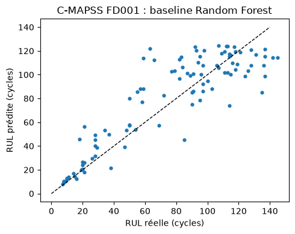

# Estimation de la RUL sur C-MAPSS (FD001) : modèle de référence

Code et résultats associés à la fiche de synthèse **« IIoT et 5G : de la donnée capteur à la décision en temps réel »**. Le notebook illustre la partie « données et ML » de la chaîne de maintenance prédictive décrite dans la fiche.

## Objectif

Estimer la durée de vie restante (RUL, *Remaining Useful Life*) de moteurs simulés avec un modèle de référence simple, puis l'évaluer avec la RMSE et le score asymétrique de la compétition PHM'08. Ce dépôt illustre la méthode : il ne prétend ni à une performance industrielle ni à un classement.

## Données

- Jeu : NASA C-MAPSS, sous-ensemble **FD001** (100 moteurs d'entraînement, 100 de test, une condition de fonctionnement, un mode de défaut : dégradation du compresseur haute pression).
- Source : https://data.nasa.gov/dataset/cmapss-jet-engine-simulated-data

## Contenu du dépôt

| Fichier | Rôle |
|---|---|
| `rul_fd001.ipynb` | Notebook complet (chargement, caractéristiques, modèle, évaluation) |
| `rul_fd001.png` | Graphique RUL prédite vs RUL réelle |
| `requirements.txt` | Dépendances Python |

## Installation et exécution

```bash
pip install -r requirements.txt
jupyter notebook rul_fd001.ipynb   # ou ouvrir le notebook dans VS Code / Codespaces
```

Exécute les cellules dans l'ordre. La graine aléatoire est fixée (`random_state=42`).

## Méthode

1. **Caractéristiques** : moyenne et écart-type glissants (fenêtre de 30 cycles) sur les capteurs non constants.
2. **Cible** : RUL calculée à partir du dernier cycle de chaque moteur d'entraînement, **plafonnée à 125 cycles** (choix de modélisation courant, absent du papier NASA).
3. **Modèle** : forêt aléatoire (`RandomForestRegressor`, 200 arbres), sans réglage d'hyperparamètres.
4. **Évaluation** : prédiction au dernier cycle observé de chaque moteur de test, comparée aux valeurs de `RUL_FD001.txt`.

## Métriques

- **RMSE** (en cycles).
- **Score NASA** (plus bas = meilleur), avec `d = RUL prédite − RUL réelle` :
  - `d < 0` (prédiction précoce) : `exp(−d / 13) − 1`
  - `d ≥ 0` (prédiction tardive) : `exp(d / 10) − 1`

Cette formulation est celle couramment utilisée dans la littérature : une prédiction tardive est plus pénalisée. Elle diffère de l'équation imprimée dans le papier PHM08, dont les constantes semblent inversées par rapport à son propre texte.

## Résultats (FD001)

| Indicateur | Valeur |
|---|---|
| RMSE | 19,8 cycles |
| Score NASA | 1 198 |
| Prédictions précoces | 37 moteurs, contribution 176 |
| Prédictions tardives | 63 moteurs, contribution 1 022 |

Le modèle tend à surestimer la durée de vie restante : les prédictions tardives représentent environ 85 % du score. Le plafonnement de la RUL à 125 cycles limite aussi les prédictions hautes.



## Limites

- Données **simulées** (moteurs d'avion), avec un seul relevé par vol : elles ne représentent pas des signaux d'usine à haute fréquence.
- Un seul jeu de test, une seule exécution, aucune validation indépendante ni réglage du modèle.
- La cellule de volumétrie (100 capteurs à 10 kHz) repose sur des **hypothèses illustratives**, pas sur des mesures.

## Références

- A. Saxena, K. Goebel, D. Simon, N. Eklund, « Damage Propagation Modeling for Aircraft Engine Run-to-Failure Simulation », PHM08, Denver, 2008.
- NASA, « C-MAPSS Jet Engine Simulated Data », data.nasa.gov.
